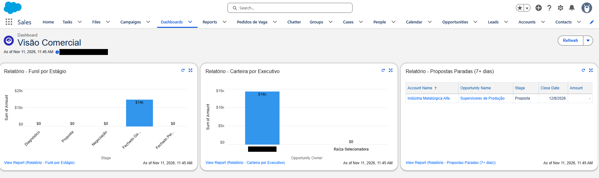
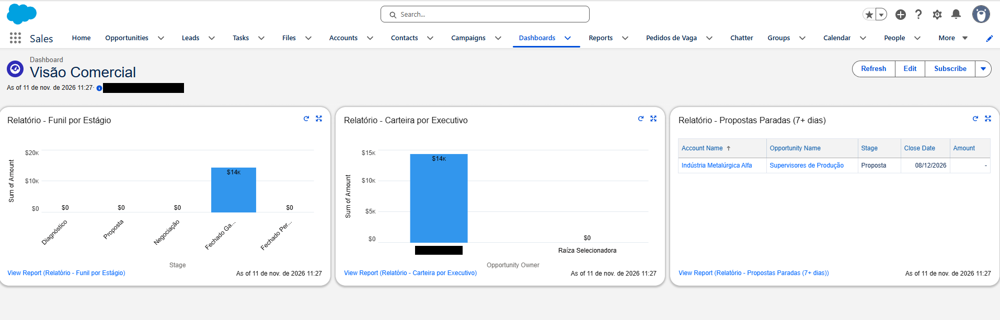
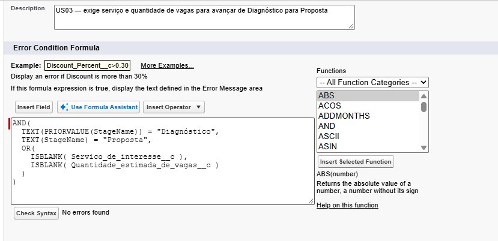
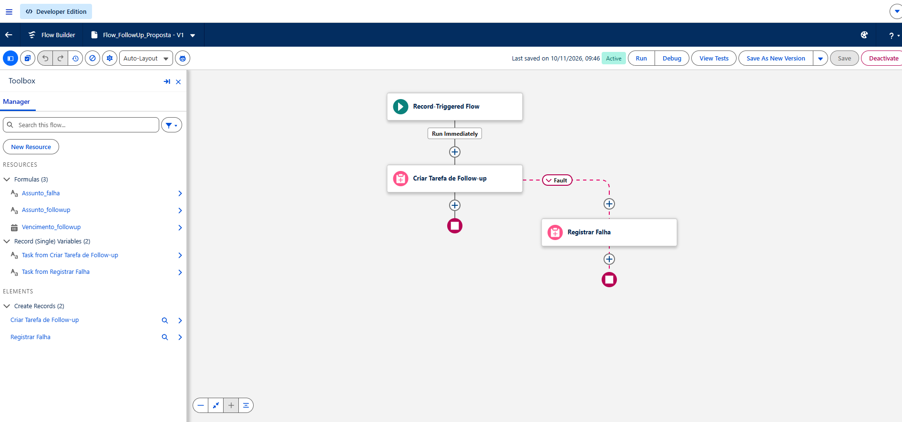

# CRM comercial do zero no Salesforce.<br>Do problema ao Dashboard.


> **A Fera Recruiting** (empresa fictícia) controlava propostas comerciais em planilha
> e o gestor pedia o funil por mensagem. Este case mostra a solução completa construída
> no Salesforce, **do problema de negócio ao dashboard** — com os requisitos, as decisões
> de modelagem e os testes que sustentam cada configuração.

**📊 6 etapas mapeadas · 10 user stories · 6 validações · 2 Flows · 27 cenários de teste · 3 relatórios + 1 dashboard**

**🔗 [Site do projeto no ar](https://marcus-vinicius-dev-ed.develop.my.site.com/portfolio) · [Vídeo walkthrough 3:10](https://www.linkedin.com/feed/update/urn:li:activity:7529182465698131968/) · [Case em PDF (8 páginas)](docs/case-crm-comercial.pdf)**

---

## 📑 Índice

- [O problema](#-o-problema)
- [A solução](#-solução)
- [Decisões de Business Analyst](#-decisões-de-business-analyst)
- [Como está construído](#-como-está-construído)
- [Resultados](#-resultados)
- [Como foi testado](#-como-foi-testado)
- [Documentação](#-documentação)

---

## 🔴 O problema

Uma consultoria de RH fictícia vendia serviços B2B e gerenciava o ciclo comercial
em **planilhas soltas e mensagens**:

| Dor | Consequência |
|---|---|
| Propostas em planilha, sem versão única | Divergência de número entre vendedores |
| Gestor pedia o funil por mensagem | Relatório montado na mão, sempre atrasado |
| Vaga aberta sem dados obrigatórios | Proposta errada, retrabalho e perda de credibilidade |
| Follow-up dependia de memória | Oportunidade esfriando sem ninguém perceber |

**Critério de sucesso definido com o "gestor" (fictício):** o funil e o dashboard
têm que responder sozinhos, sem pedir planilha a ninguém.

## 🟢 A solução

| Problema | Solução no Salesforce | Evidência |
|---|---|---|
| Sem visão do funil | 3 relatórios + 1 dashboard para o gestor | Prints em `prints/` |
| Dado ruim entrando | 6 regras de validação | `S3-01-pub.png` |
| Follow-up na memória | Record-Triggered Flow criando tarefa | `S3-22-pub.png` |
| Abertura de vaga manual | Flow de Pedido de Vaga ao ganhar | `S3-25-pub.png` |
| Perfis sem controle | Hierarquia de papéis + permission sets | `S3-31/34/37-pub.png` |
| Processo opaco | 6 etapas com critérios de avanço | `S3-45-pub.png` |

## 🧠 Decisões de Business Analyst

> Esta é a parte que separa **configurar** de **entender o negócio**.

1. **Escopo recusado de propósito.** Das ideias levantadas, várias ficaram de fora
   (integração com e-mail, previsão de fechamento por IA, gamificação). Escolher
   o que **não** fazer foi a decisão de BA que mais marcou o projeto — e está
   documentada com o porquê.
2. **Estágios com critério, não com opinião.** Cada etapa do funil exige dados
   obrigatórios antes de avançar, para a proposta nunca sair pela metade.
3. **Validação perto de quem erra.** As 6 regras bloqueiam na hora da digitação
   com mensagem clara, não em relatório depois.
4. **Automatizar só o que gera valor.** 2 Flows, não 10: follow-up e abertura de
   vaga — o resto ficou manual de propósito (menos manutenção, menos quebra).

## 🛠️ Como está construído

```
Modelo de dados
├── Oportunidade (6 estágios personalizados)
│   ├── Diagnóstico (seção dedicada no layout)
│   ├── Validações de serviço e quantidade de vaga
│   └── Produtos no Price Book
├── Pedidos de Vaga (criados por Flow ao ganhar)
├── Tarefas de follow-up (criadas por Flow)
└── Segurança
    ├── Hierarquia de papéis (Gestor → Executivo → Selecionadora)
    ├── Permission sets por perfil de uso
    └── Perfis com acesso mínimo necessário
```

| Camada | Tecnologia |
|---|---|
| Dados | Objetos personalizados, campos, relações, price book |
| Automação | 2 Record-Triggered Flows (follow-up, pedido de vaga) |
| Governança | 6 regras de validação, estágios com critérios |
| Segurança | Papéis, perfis, permission sets |
| Visão | 3 relatórios + 1 dashboard |
| Experiência | Site público no Experience Cloud (acesso de convidado) |

## 📈 Resultados

**Dashboard "Funil por Executivo"** — o gestor abre e responde as próprias perguntas:



**Relatório "Funil por Executivo":**



**Validação barrando dado errado:**



**Flow do follow-up:**



> A galeria completa com 31 prints (modelo de dados, Flows, perfis, relatórios
> e testes) está em [`prints/`](prints/).

## ✅ Como foi testado

- **27 cenários de teste** cobrindo as 10 user stories (matriz de rastreabilidade
  requisito → caso de teste)
- Cada configuração foi validada com **print de evidência** antes de publicar
- Testes executados em **2 perfis diferentes** para provar o modelo de segurança

## 📚 Documentação

| Documento | O que responde |
|---|---|
| [Case completo — 8 páginas (PDF)](docs/case-crm-comercial.pdf) | Visão executiva: problema → solução → aprendizados |
| [Estrutura do case](docs/00-estrutura-do-case.md) | Como as 8 páginas foram montadas |
| [Plano de posts](docs/01-plano-de-posts.md) | Estratégia de comunicação do projeto |
| [Textos publicados](docs/03-textos-publicacao.md) | O que foi dito no LinkedIn |

## 🔗 Mais sobre o projeto

- **🌐 [Site do projeto (Experience Cloud)](https://marcus-vinicius-dev-ed.develop.my.site.com/portfolio)** — página pública com o case, o vídeo e os links
- **▶️ [Vídeo walkthrough (3:10)](https://www.linkedin.com/feed/update/urn:li:activity:7529182465698131968/)** — o projeto inteiro funcionando, com narração
- **💼 [Perfil no LinkedIn](https://www.linkedin.com/in/marcusviniciussilencio/)**

---

<sub>Projeto de portfólio construído em uma org Developer Edition. **Empresa fictícia** —
Fera Recruiting não existe; todos os dados são de demonstração. © 2026 Marcus Vinicius Silencio.</sub>
